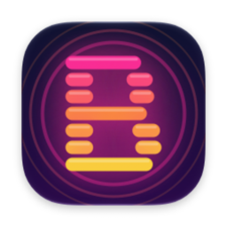
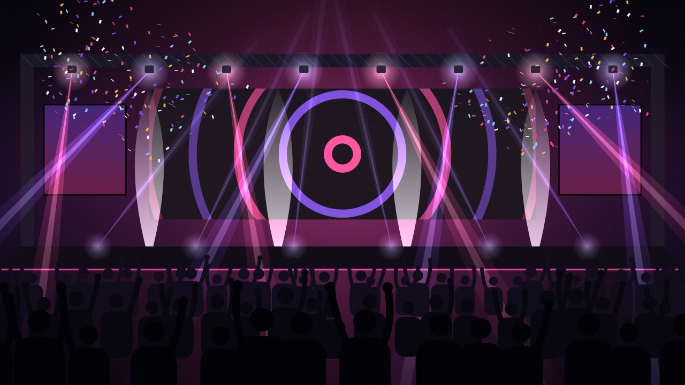
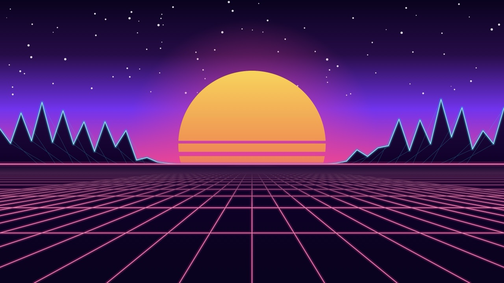
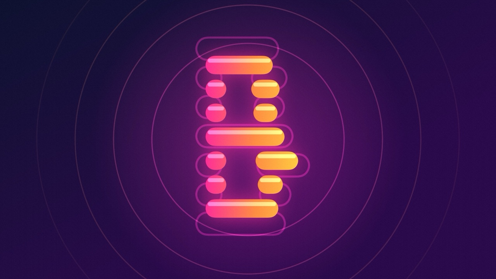
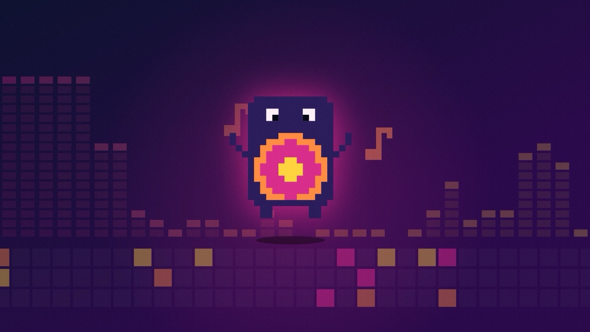

  

<h1 align="center">BeatsWall</h1>

  Live wallpapers for your Mac that dance to whatever's playing. 
  17 collections · 57 live wallpapers · macOS 15 or later

  
  
  
  

BeatsWall listens to your Mac's sound output, so it works with Spotify, Apple Music, YouTube or anything else. Your desktop wallpaper reacts to the beat, the bass and the melody as the song plays. Audio is analyzed on your Mac as it plays. It's never recorded, saved or sent anywhere.

> **BeatsWall is in private beta.** Builds expire after about 60 days. The app tells you when a newer build is out.

## Features

- **57 live wallpapers in 17 collections:**
  - BeatsWall
  - Concert
  - Light Show
  - Skateboarding
  - Synthwave
  - Space
  - Ocean & Nature
  - Lo-fi Chill
  - Halloween
  - Retro Arcade
  - Neon Tokyo
  - Winter Holidays
  - Deep Sea
  - Abstract Minimal
  - Cyberpunk
  - Tropical Jungle
  - Desert Night
- **Concert Mode:** a concert stage for the song playing in Apple Music or Spotify, lit in its album art's colors with its name on the screens. BeatsWall picks the stage that suits the song, or you can shuffle or choose one.
- **Lighting desk:** colors, laser patterns, strobe, fog, intensity and movement for the Concert and Light Show stages.
- **Stage image:** put your own picture on the screens of every concert stage.
- **Remix Maker:** search Apple Music or add songs from your library. BeatsWall mixes them into an intro, each song's best part tempo-matched and crossfaded on the beat, and an outro, then plays it as a live show on your desktop.
- **Synced lyrics:** karaoke-style lyrics on your wallpaper for songs playing in Apple Music or Spotify.
- **Shuffle:** a new wallpaper on every bar.
- **Record Clip:** turn any wallpaper and song into a vertical, square or landscape video for TikTok, Reels or Shorts, credited to your @handle.
- **Show Mode:** the wallpaper full screen on a TV or second monitor, for filming your setup.
- **Easy on your Mac:**
  - pauses when windows cover the desktop or in Low Power Mode
  - a lighter-effects mode for streaming
  - a separate wallpaper for each display

## Installing the beta

1. Download the latest `BeatsWall-….dmg` from [Releases](../../releases/latest).
2. Open it and drag **BeatsWall** onto **Applications**.
3. Open BeatsWall from Applications. macOS will say it can't check it for malware, because the beta isn't notarized yet. Click **Done**.
4. Open **System Settings › Privacy & Security**, scroll down, and click **Open Anyway** next to BeatsWall. You only need to do this once.
5. When asked, allow BeatsWall to capture your Mac's audio, so it can find the beat.

BeatsWall lives in the menu bar. Click the **B** icon to choose wallpapers and turn on Concert Mode, Shuffle, Lyrics and the Remix Maker.

## Building from source

You need Xcode 26 or later. Open `BeatsWall.xcodeproj` and run the **BeatsWall** scheme.

| Script | What it does |
|---|---|
| `Tools/make-dmg.sh` | Builds a universal beta DMG on your Desktop and writes `latest.json` for update alerts. Set `FEEDBACK_EMAIL` for the Send Feedback button. |
| `Tools/render-trailer.sh` | Renders the 45-second trailer, cut to the beat of any song. |
| `Tools/make-icon.swift` | Regenerates the app icon. |

### How it's organized

| Folder | Contents |
|---|---|
| `BeatsWall/Audio` | System audio capture and the beat, tempo and spectrum analysis. |
| `BeatsWall/Collections` | One folder per collection. Each wallpaper is a SwiftUI `Canvas` driven by the analyzed audio. |
| `BeatsWall/Desktop` | The windows behind the desktop icons, and Show Mode. |
| `BeatsWall/Lyrics` | Now playing in Music and Spotify, and synced lyrics from [LRCLIB](https://lrclib.net). |
| `BeatsWall/Remix` | Song search, the remix engine and the remix live show. |
| `BeatsWall/Video` | Offline frame-by-frame rendering for clips and the trailer. |
| `BeatsWall/UI` | Menu bar, settings, onboarding and the app's windows. |

## Music and rights

BeatsWall doesn't record or redistribute music. Remixes and clips are made from songs you supply, or from Apple Music's 30-second previews, for your own listening. If you post a clip, make sure you have the rights to the music in it.
